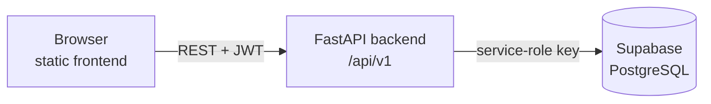

# Brightloop

A subscription billing platform for businesses that sell on a recurring plan. It covers the whole
cycle in one place: product and plan setup, quotes, subscriptions, an automated billing run,
invoices, payments and reporting.

There are three roles, **admin**, **staff** and **customer**, and each one gets a dashboard built
around their job.

**Contents:** [Features](#features) · [Tech stack](#tech-stack) · [Architecture](#architecture) ·
[Project structure](#project-structure) · [Getting started](#getting-started) ·
[How billing works](#how-billing-works) · [Roles and permissions](#roles-and-permissions) ·
[API overview](#api-overview) · [Configuration](#configuration) · [Testing](#testing) ·
[Troubleshooting](#troubleshooting) · [Before you deploy](#before-you-deploy)

---

## Features

**Dashboards, one per role**

| Role | What the dashboard shows |
|---|---|
| **Admin** | Platform overview: monthly recurring revenue, collected revenue, users by role, top customers, catalog and tax setup, discount code usage, newest accounts and system status. |
| **Staff** | A daily work queue: overdue invoices to chase, quotes to move forward, subscriptions due to bill this week, receivables by age, the subscription pipeline and what is left to collect. |
| **Customer** | Their own account: subscriptions, invoices with a one-click Pay, payment history and plans they can request a quote for. They only ever see their own data. |

**Platform**

- Sign-up and login with JWT, password reset, a password policy, and instant sign-out of old
  sessions when a password changes.
- Catalog of products, variants and plans (day, week, month or year billing, trial days).
- Quotation templates that turn into draft subscriptions in one click.
- Subscription lifecycle: draft, quotation, confirmed, active, paused, closed, plus renew.
- Taxes per line item, and discount codes (percentage or fixed, usage limits, validity dates).
- A billing run that is safe to repeat: it never bills the same period twice, and has a dry-run
  preview.
- Invoices with a printable view, and payments that update the invoice balance and status.
- Charts drawn in plain SVG (revenue trend, invoice status, billed vs collected, receivables by
  age and more), loading skeletons and a layout that works on phones.

All money is stored as **whole rupees (INR)**.

---

## Tech stack

| Layer | Technology |
|---|---|
| Backend | Python 3.10+ (developed on 3.13), **FastAPI**, Uvicorn, Pydantic v2 |
| Database | **Supabase** (hosted PostgreSQL), accessed through the `supabase` client |
| Auth | JWT access tokens (`python-jose`, HS256), bcrypt password hashes (`passlib`) |
| Frontend | Plain **HTML, CSS and JavaScript**: no framework and no build step |
| Charts | Hand-written SVG (`frontend/js/charts.js`), no chart library |
| Fonts | Geist from Google Fonts, with a system-font fallback |

Python packages are pinned in `backend/requirements.txt`. The frontend has no packages to install.

---

## Architecture



- The frontend is a set of static files. It calls the backend's REST API and keeps its sign-in
  token in the browser.
- The backend holds all the rules: who can do what, billing, taxes, discounts. The frontend only
  hides what a role cannot use. The backend is what actually enforces it.
- Only the backend talks to the database, using Supabase's server-side service key. That key never
  goes to the browser.

---

## Project structure

```
Brightloop/
├── backend/
│   ├── app/
│   │   ├── api/v1/endpoints/   auth, users, products, variants, plans, billing
│   │   ├── core/               config, database client, security, dependencies, money helpers
│   │   ├── schemas/            Pydantic request and response models
│   │   ├── services/           business logic and database queries
│   │   └── main.py             FastAPI app, error handling, /health
│   ├── sql/                    numbered database migrations, 001 to 005
│   ├── scripts/                live_smoke.ps1 and cleanup_smoke.py
│   ├── tests/                  automated access-control tests (pytest)
│   ├── .env.example            template for your secrets
│   ├── requirements.txt        runtime packages
│   ├── requirements-dev.txt    adds pytest for the tests
│   └── TESTING.md              manual API test plan
└── frontend/
    ├── index.html
    ├── css/styles.css          the design system
    └── js/
        ├── config.js           the backend address
        ├── charts.js           SVG charts
        └── app.js              sign-in, views, forms, dashboards
```

---

## Getting started

**You need:** Python 3.10 or newer, and a free [Supabase](https://supabase.com) account.

Commands below are for Windows PowerShell. On macOS or Linux, use `source venv/bin/activate`
instead of `.\venv\Scripts\...` and `cp` instead of `copy`.

### 1. Database (once per new database)

All of the database structure lives in numbered SQL files in `backend/sql/`. They are the single
source of truth, so this is also how you rebuild the database if you ever lose it.

1. Create a project at [supabase.com](https://supabase.com).
2. Open **SQL Editor, New query**.
3. For each file below, **in this order**: open it in your editor, copy the whole file, paste it
   into the SQL Editor and click **Run**. Wait for "Success" before starting the next one.

| Order | File | What it creates |
|---|---|---|
| 1 | `001_users.sql` | `users` table, the `admin`/`staff`/`customer` role type, the `updated_at` trigger, row-level security |
| 2 | `002_user_auth.sql` | `token_version` column on `users` (lets a password change sign out old sessions) |
| 3 | `003_catalog.sql` | `products`, `product_variants` and `plans` |
| 4 | `004_money_to_rupees.sql` | Converts plan prices to whole rupees (`price_paise` becomes `price_inr`) |
| 5 | `005_subscriptions_billing.sql` | `taxes`, `discounts`, `quotation_templates`, `subscriptions`, `subscription_lines`, `invoices`, `invoice_lines`, `payments`, `password_resets` |

Every file can be run again safely, but **the order matters**: `004` changes a column that `003`
creates, and `005` builds on all of them.

To check it worked, run this in the SQL Editor. You should see 13 tables:

```sql
select table_name from information_schema.tables
where table_schema = 'public' order by table_name;
```

When you change the database later, add a new numbered file (for example `006_something.sql`)
instead of editing an old one, and run only the new file on an existing database.

> Never put database backups or exports in this repository. They contain customer data and
> password hashes.

### 2. Backend

```powershell
cd backend
python -m venv venv
.\venv\Scripts\pip install -r requirements.txt
copy .env.example .env
```

Open `backend/.env` and fill in the values (see [Configuration](#configuration)). In Supabase,
the URL and service key are under **Project Settings, API**. Generate a secret for `JWT_SECRET`:

```powershell
.\venv\Scripts\python -c "import secrets; print(secrets.token_urlsafe(48))"
```

Start the server:

```powershell
.\venv\Scripts\uvicorn app.main:app --reload
```

The API is now at http://127.0.0.1:8000. Check http://127.0.0.1:8000/health, and browse the
interactive docs at http://127.0.0.1:8000/docs.

### 3. Frontend

In a second terminal:

```powershell
cd frontend
python -m http.server 5173
```

Open http://127.0.0.1:5173. If the backend runs on another address or port, change it in
`frontend/js/config.js`.

### 4. Your first sign-in

Pick one:

- **Try it with sample data.** Set `BOOTSTRAP_TOKEN` in `backend/.env` to any long random string
  and restart the backend. On the sign-in page, click **Load demo data** and enter that token. It
  adds sample products, plans, subscriptions, invoices and payments, and creates these accounts
  if they do not exist yet:

  | Role | Email | Password |
  |---|---|---|
  | Admin | `arjun@brightloop.in` | `Admin@2026` |
  | Staff | `priya@brightloop.in` | `Staff@2026` |
  | Customer | `contact@technova.io` | `Customer@2026` |

  Loading demo data **replaces** the existing catalog and billing rows, so only use it on a fresh
  or test database. Existing accounts keep their own passwords. Without a `BOOTSTRAP_TOKEN`, the
  loader is switched off.

- **Create your own admin.** Set `BOOTSTRAP_TOKEN` in `.env`, then register through the API docs
  (`POST /api/v1/users/register`) with the header `X-Bootstrap-Token: <your token>` and
  `"role": "admin"`. Anyone can register as a customer from the sign-in page.

Passwords need 9 or more characters, with upper and lower case letters and a special character.

---

## How billing works

**Subscription lifecycle**

```
draft → quotation → confirmed → active ⇄ paused
```

A draft can also be confirmed directly. Any of these states can move to **closed**, and a closed
subscription can return to draft. An active or closed subscription can be **renewed**.

**The billing run** ("Billing Day") looks at every *active* subscription whose next billing date
has arrived, and for each one:

1. Builds an invoice from the subscription's line items (or the plan price if it has none), with
   each line's tax.
2. Applies the subscription's discount code if it is valid.
3. Sets the due date from the payment terms: `immediate`, `net15`, `net30` or `net60`.
4. Moves the next billing date forward by the plan's interval.

If an invoice already exists for that subscription and period, it is skipped, so running billing
twice is safe. Use the **dry run** to preview without saving anything.

**Invoices and payments.** An invoice is `draft`, `confirmed`, `paid` or `cancelled`, and shows as
*overdue* once its due date has passed while it is unpaid. Recording a payment adds to the
invoice's paid amount and marks it `paid` when fully covered. Payment methods are bank transfer,
credit card, UPI, cash, cheque and portal online.

---

## Roles and permissions

| Area | Customer | Staff | Admin |
|---|---|---|---|
| Subscriptions, invoices, payments | their own only: view, pay, confirm, pause, resume, close, renew | all customers | all customers |
| Create a subscription or request a quote | a request for themselves (starts as a draft at the plan price) | for any customer, with their own pricing and discount | for any customer, with their own pricing and discount |
| Activate or edit a subscription | no (staff review requests first) | yes | yes |
| Run billing, send, confirm or cancel invoices | no | yes | yes |
| Quotation templates | view, request a quote | view, create | view, create |
| Taxes | view | view | view, create |
| Discount codes | no | view | view, create |
| Products, variants, plans | view | view | view, create, edit, delete |
| Users and roles | no | no | manage |
| Finance dashboard report | no | yes | yes |

---

## API overview

Everything is under `/api/v1`. Send the token from `/auth/login` as `Authorization: Bearer <token>`.
The full, interactive reference is at `/docs`.

| Group | Endpoints |
|---|---|
| Auth | `POST /auth/login`, `POST /auth/token`, `POST /auth/forgot-password`, `POST /auth/reset-password` |
| Users | `POST /users/register`, `GET /users/me`, `POST /users/me/change-password`, `GET /users`, `PATCH /users/{id}/role`, `POST /users/{id}/activate`, `POST /users/{id}/deactivate` |
| Catalog | `/products`, `/variants`, `/plans` (create, list, get, update, delete) |
| Taxes and discounts | `GET` and `POST /taxes`, `GET` and `POST /discounts`, `POST /discounts/validate` |
| Quotations | `GET` and `POST /quotation-templates`, `POST /quotation-templates/{id}/create-quote` |
| Subscriptions | `GET` and `POST /subscriptions`, `GET` and `PATCH /subscriptions/{id}`, then `POST` to `.../to-quotation`, `confirm`, `activate`, `pause`, `resume`, `close`, `renew` |
| Billing | `POST /billing/run`, `GET /billing/preview` |
| Invoices | `GET /invoices`, `GET /invoices/{id}`, `POST` to `.../confirm`, `cancel`, `send`, `GET .../print` |
| Payments | `GET /payments`, `POST /payments` |
| Reports | `GET /reports/dashboard` |
| Demo | `POST /demo/seed`, needs the `X-Bootstrap-Token` header |

Other endpoints: `GET /health` and `GET /` (a pointer to the docs).

---

## Configuration

**Backend**, in `backend/.env`:

| Variable | Required | Meaning |
|---|---|---|
| `SUPABASE_URL` | yes | Project URL from Supabase, Project Settings, API |
| `SUPABASE_SERVICE_ROLE_KEY` | yes | The service role key. Server-side only, never commit it |
| `JWT_SECRET` | yes | At least 32 characters; signs sign-in tokens |
| `BOOTSTRAP_TOKEN` | no | Unlocks two setup actions through the `X-Bootstrap-Token` header: creating admin or staff accounts, and loading demo data. Leave empty to turn both off |
| `JWT_ALGORITHM` | no | Default `HS256` |
| `JWT_ISSUER` | no | Default `brightloop-api` |
| `ACCESS_TOKEN_EXPIRE_MINUTES` | no | Default `60` |

**Frontend**, in `frontend/js/config.js`: `BRIGHTLOOP_API`, the backend address
(default `http://127.0.0.1:8000/api/v1`).

---

## Testing

**Automated tests.** They check the access rules (a customer cannot touch someone else's
subscription, customers cannot set their own prices or status, demo data needs the token). They
run in memory with no database or `.env`:

```powershell
cd backend
.\venv\Scripts\pip install -r requirements-dev.txt
.\venv\Scripts\python -m pytest
```

**Against a real database.** `backend/TESTING.md` is a manual test plan for the API, and
`backend/scripts/live_smoke.ps1` drives the real API with an admin account, creates clearly
labelled test data, checks the main flows, then deletes what it created. Run
`.\scripts\live_smoke.ps1 -PreflightOnly` first for a read-only check.

---

## Troubleshooting

| What you see | What to do |
|---|---|
| "Database schema is out of date" | A migration is missing. Run the SQL files in `backend/sql/` in order, up to `005`. |
| "Database authentication failed" | `SUPABASE_URL` or `SUPABASE_SERVICE_ROLE_KEY` in `backend/.env` is wrong. |
| An error about `JWT_SECRET` | Set `JWT_SECRET` in `.env` to a value of at least 32 characters. |
| "Cannot reach the backend" in the web app | Start the backend, or fix the address in `frontend/js/config.js`. |
| Demo admin says "Invalid email or password" | That account already existed and keeps its own password. Use **Forgot password** on the sign-in page. In demo mode it shows the reset token on screen. |
| "Demo data is disabled" or "Invalid or missing X-Bootstrap-Token" | Set `BOOTSTRAP_TOKEN` in `backend/.env`, restart the backend, and enter exactly that value when asked. |
| Port 8000 is already in use | Start uvicorn with `--port 8001` and update `config.js`. |
| The page looks unstyled or out of date | Hard refresh with Ctrl+F5. |
| Install fails around bcrypt or passlib | Reinstall with `pip install -r requirements.txt`; `bcrypt` is pinned below 4.1 on purpose. |

---

## Before you deploy

This project is ready to run and learn from. A few things are intentionally simple and need
attention before it faces real customers:

- **Turn off the setup token.** `BOOTSTRAP_TOKEN` can create admin accounts and wipe the catalog
  and billing data by loading demo data. After you have your own admin, remove it from `.env` (or
  use a long random value you keep private).
- **No payment gateway.** Payments are recorded by hand. "Portal online" is only a label.
- **No email.** Password-reset tokens are returned in the API response, and "send invoice" only
  marks the invoice as sent. Plug in an email service and stop returning the token.
- **Billing is triggered manually.** There is no scheduler; run it from the Billing page or call
  the API from a scheduled job.
- **CORS allows every origin.** Restrict it to your frontend's address in `backend/app/main.py`.
- Serve both parts over HTTPS, keep `.env` out of git, and rotate any key that was ever shared.
- A single currency (INR) is supported.
